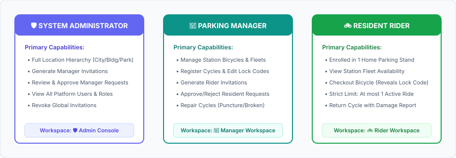
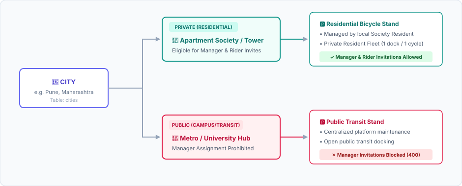
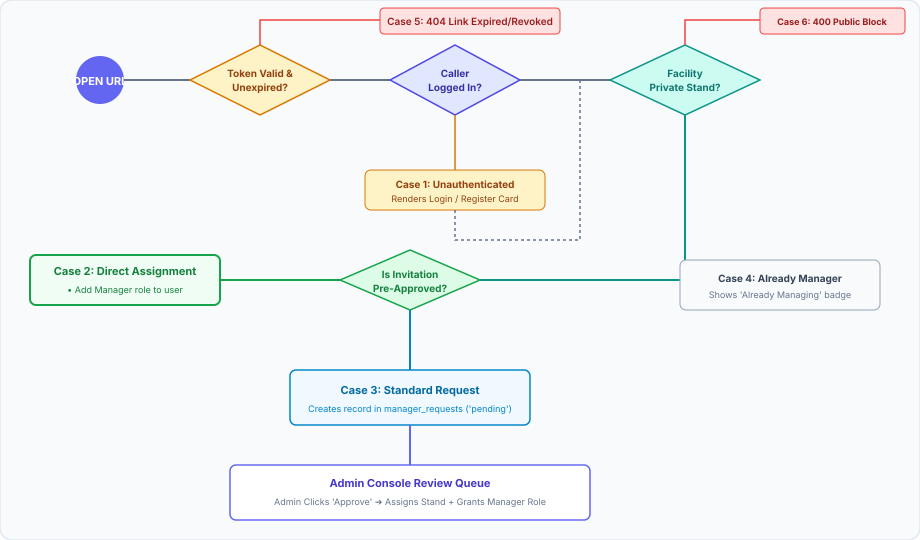
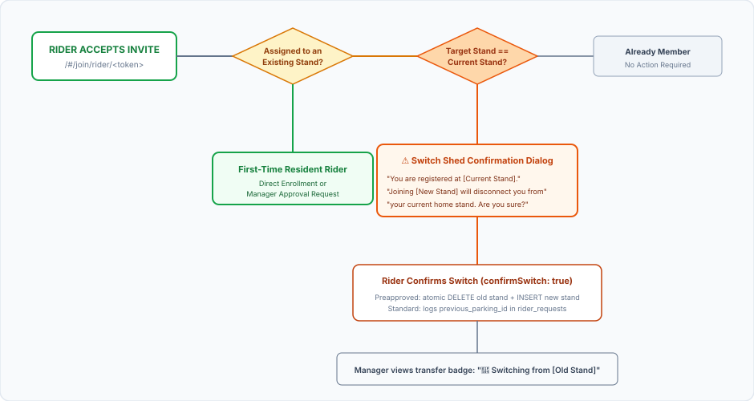
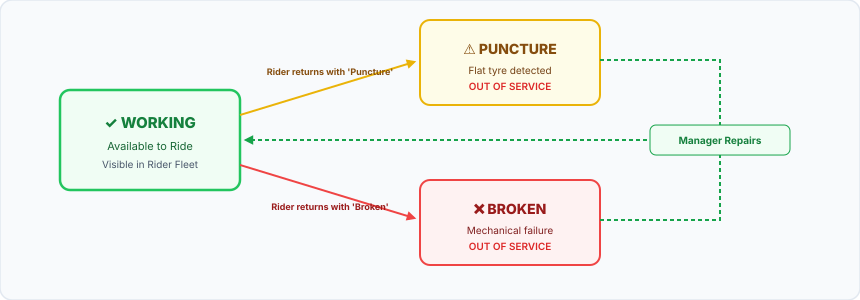
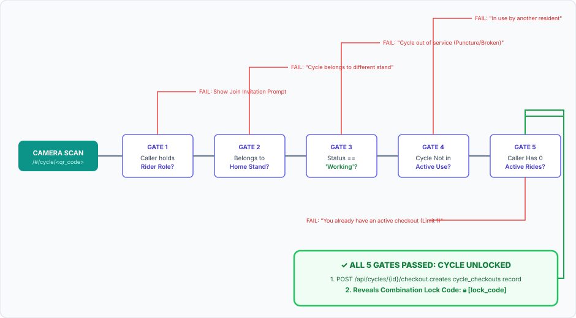
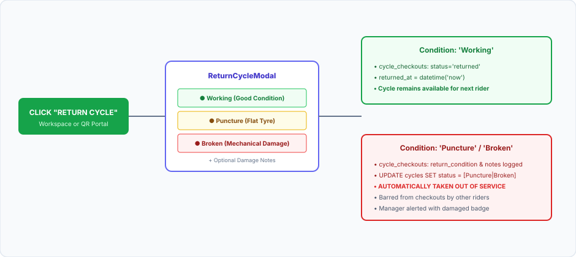

# Bycme User Flows & State Machines

## 1. System Personas & Actor Hierarchy

### 1.1 Actors & Role Boundaries

### 1.2 Persona & Workspace Access Matrix

| Role | Default Workspace | Gated API Scope | Multi-Assignment Policy |
| :--- | :--- | :--- | :--- |
| **System Administrator** | `🛡️ Admin Console` | All endpoints (`/api/cities`, `/api/buildings`, `/api/parkings`, `/api/admin/*`, `/api/persons`) | Global platform scope |
| **Parking Manager** | `🏢 Manager Workspace` | Assigned parkings (`/api/me/parkings`, `/api/parkings/{id}/cycles`, `/api/parkings/{id}/rider-invitations`) | Allowed multiple private stands |
| **Resident Rider** | `🚲 Rider Workspace` | Assigned home stand (`/api/me/home-parking`, `/api/me/active-checkout`, `/api/cycles/{id}/checkout`) | Strict 1-stand limit (`parking_riders`) |
| **Anonymous Visitor** | Public Landing / Portal | Public lookup (`/api/health`, `/api/auth/*`, `/api/invitations/{token}`, `/api/cycles/lookup/{id}`) | None (Session unauthenticated) |

---

## 2. Location Infrastructure & Classification Flow

### 2.1 3-Tier Hierarchy & Facility Privacy Guardrails

### 2.2 Facility Classification Rules

| Facility Type | Domain Context | Manager Eligibility | Resident Rider Scope |
| :--- | :--- | :--- | :--- |
| **Private (Residential)** | Apartment societies, residential towers | **Eligible** (Assigned by Admin or claimed via invite) | Private resident roster with active single-shed checkouts |
| **Public (Campus / Office / Transit)** | Metro stations, university campuses, IT parks | **Blocked** (`400 Bad Request` on invitation generation) | Open transit docking; central platform management |

---

## 3. Manager Invitation & Onboarding State Machine

### 3.1 Invitation Generation & Lifecycle
* **Link Route**: `https://bycme-staging.pages.dev/#/join/mgr/<token>`
* **Token Structure**: 16-byte cryptographically secure random base64url token (22 chars)
* **Parameters**: Expiration duration (`1h`, `6h`, `24h`, `7d`), Preapproval toggle (`isPreapproved: boolean`)

### 3.2 Decision State Diagram

### 3.3 Manager Onboarding Decision Matrix

| Case | Scenario | User State | System Action | Resulting Assignment |
| :--- | :--- | :--- | :--- | :--- |
| **Case 1** | Unauthenticated link visit | No session token | Presents login / registration modal | Prompts credentials before evaluating link |
| **Case 2** | Preapproved invitation | Authenticated user | Direct claim without admin review | Stand assigned in `parking_managers`; role upgraded to `Manager` |
| **Case 3** | Standard (non-preapproved) invitation | Authenticated user | Creates record in `manager_requests` (`status = 'pending'`) | Awaits admin approval from Admin Console |
| **Case 4** | Already managing target stand | Assigned manager | Displays idempotent "Already Managing" badge | No duplicate record created |
| **Case 5** | Expired or revoked link | Any user | Returns `404 Not Found` with error alert | Terminal state |
| **Case 6** | Public facility invitation attempt | Any user | Rejection with `400 Bad Request` | Invitations restricted to Private residential stands |

---

## 4. Rider Invitation & Single-Shed Transfer Flow

### 4.1 Strict Single-Shed Policy
* Every resident rider is strictly bound to **at most one** bicycle parking stand (`parking_riders.person_id UNIQUE`).
* When an active rider accepts an invitation to a new parking stand, the system presents an explicit **Switch Parking Shed Confirmation Dialog**.

### 4.2 Rider Acceptance & Shed Transfer Decision Matrix

### 4.3 Rider Transfer Decision Matrix

| Scenario | Prior Enrollment | User Action | System Execution | Final State |
| :--- | :--- | :--- | :--- | :--- |
| **First-Time Rider (Preapproved)** | None | Accept invitation | Adds `Rider` role + inserts `parking_riders` | Direct home stand activation |
| **First-Time Rider (Standard)** | None | Request access | Submits `rider_requests` (`is_switch = 0`) | Manager approval queue |
| **Existing Rider (Preapproved)** | Stand A | Confirms switch (`confirmSwitch: true`) | Atomic transaction: deletes Stand A + inserts Stand B | Seamlessly transferred to Stand B |
| **Existing Rider (Standard)** | Stand A | Confirms switch (`confirmSwitch: true`) | Submits `rider_requests` with `previous_parking_id = Stand A` | Manager reviews transfer with old stand badge |
| **Idempotent Visit** | Stand A | Visits Stand A invite | Displays "Already Registered at This Stand" | No state change |

---

## 5. Cycle Fleet Management & Condition State Machine

### 5.1 Cycle Attributes
* `public_cycle_id`: Auto-assigned sequence (`PUN-001`, `BLR-001`, `CYC-001`)
* `lock_code`: Secret mechanical code (hidden from public view, numbers-only)
* `qr_code`: Scannable compact token deep-linked to `/#/cycle/<qr_code>`
* `status`: Current physical condition

### 5.2 Condition State Machine

### 5.3 Physical Status Lifecycle

| Status | Availability | Trigger | Next Allowed Transition |
| :--- | :--- | :--- | :--- |
| **`Working`** | **Available** (Eligible for checkout) | Manager initial registration or post-repair reset | ➔ `Puncture` or `Broken` upon rider return |
| **`Puncture`** | **Blocked** (Out of service) | Rider reports flat tyre on return modal | ➔ `Working` once repaired by manager |
| **`Broken`** | **Blocked** (Out of service) | Rider reports mechanical damage on return modal | ➔ `Working` once repaired by manager |

---

## 6. Scan-to-Ride QR & Checkout Flow (`/#/cycle/<qr_code>`)

### 6.1 Scan-to-Ride 5-Gate Verification Flowchart

### 6.2 Five Verification Gates Specification

| Gate | Validation Check | Failure Code & UI Message |
| :--- | :--- | :--- |
| **Gate 1: Role** | Caller holds `Rider` role in `person_roles` | `403 Forbidden`: Displays prompt to register or accept resident invitation |
| **Gate 2: Stand** | Cycle stationed at rider's assigned home parking stand | `400 Bad Request`: "Cycle belongs to [Stand]. You can only checkout cycles at your home stand." |
| **Gate 3: Condition** | Cycle condition is strictly `'Working'` | `400 Bad Request`: "This cycle is currently marked as '[Puncture/Broken]' and is unavailable." |
| **Gate 4: In Use** | Zero active checkouts on this specific cycle | `400 Bad Request`: "This cycle is currently in use by another resident." |
| **Gate 5: Limit** | Caller has zero active checkouts (Strict 1-cycle limit) | `400 Bad Request`: "You already have an active cycle checkout. Return your active cycle first." |

---

## 7. Cycle Return & Damage Reporting Flow

### 7.1 Condition Reporting Flowchart

### 7.2 Post-Return Verification Summary

| Checkpoint | Working Return | Puncture / Broken Return |
| :--- | :--- | :--- |
| `cycle_checkouts.status` | Set to `'returned'` | Set to `'returned'` |
| `cycle_checkouts.return_condition` | `'Working'` | `'Puncture'` or `'Broken'` |
| `cycle_checkouts.return_notes` | Null or optional note | Problem description saved |
| `cycles.status` | Unchanged (`'Working'`) | Updated immediately to `'Puncture'` or `'Broken'` |
| Next Rider Availability | Available immediately | **Blocked** (Gate 3 rejects checkout) |
| Manager Workspace Action | None required | Status badge alerts manager to repair cycle |
